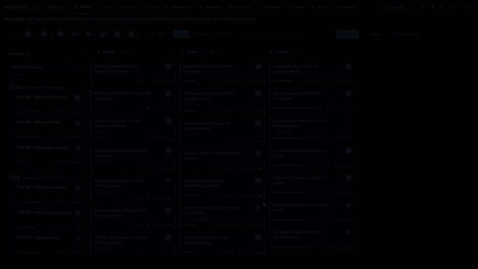

# Flowboards

**A complete re-imagining of the Azure DevOps UI experience, taken to the next level. Once tried, never go back.**

**[▶ Try the live demo](https://flowboards.dev/demo/)**: the real extension on a made-up team, right in your browser. No sign-in, nothing to install. Click, drag and edit anything; your changes stay in your browser. Then install it here, free.

Website: [flowboards.dev](https://flowboards.dev/) · Code: [GitHub](https://github.com/Volodymyr-Usov/flowboards) · Made by Volodymyr Usov: [usovvova.com](https://usovvova.com)

*Pick a Feature and its stories light up. Drag a story to a new parent, let a column rule stop a move until the task is there, see tasks, pull requests and owner right on the card. Then a quick look at Flow, Backlog search, Dependencies, Roadmap and Strategy.* **[Try it yourself](https://flowboards.dev/demo/)**

## Ten things Azure DevOps can't do easily. Flowboards does them now.

1. **"When will it be done?" answered with a date.** A Monte Carlo forecast from your team's real pace: "85% likely by 14 Nov". *Azure DevOps: a velocity line, no date and no likelihood.* [Try it](https://flowboards.dev/demo/#flow)
2. **A Feature's stories across the whole board.** Pick a Feature and its stories light up in every column, joined to it by lines. *Azure DevOps: you open the stories one by one, or switch to the backlog.* [Try it](https://flowboards.dev/demo/#board)
3. **Change a story's parent by dragging it on the board.** Drop the card on another Feature; no form to open. *Azure DevOps: only in the story's form or the backlog's mapping pane.* [Try it](https://flowboards.dev/demo/#board)
4. **Column rules that stop a bad move and fix it on the spot.** "Ready needs a description", "Active needs a task", "Only the product owner may close it". *Azure DevOps: a column's definition of done is only a note.* [Try it](https://flowboards.dev/demo/#board)
5. **Search that keeps the tree.** Every match in the backlog keeps its Epic and Feature around it. *Azure DevOps: a filtered backlog drops the parents.* [Try it](https://flowboards.dev/demo/#tree)
6. **Recurring stories that make themselves.** The weekly review or the release checklist, written once as a schedule with tasks and a rotating owner. *Azure DevOps: nothing built in.* [Try it](https://flowboards.dev/demo/#scheduler)
7. **A dependency map: what is blocked, and by what.** Every "waits for" link as a graph, blocked work listed and loops flagged. *Azure DevOps: lines on a Delivery Plan, no list and no loop check.* [Try it](https://flowboards.dev/demo/#deps)
8. **A roadmap that says what will be late.** Each Epic and Feature gets a "likely done by" date, red when it will probably miss its target; other teams sit in their own rows. *Azure DevOps: Delivery Plans do not forecast.* [Try it](https://flowboards.dev/demo/#roadmap)
9. **Pull request times for your team.** How long your team's pull requests wait for the first approval and take to merge, and who they wait on now. *Azure DevOps: no such report per team.* [Try it](https://flowboards.dev/demo/#prs)
10. **Health checks with the fix one click away.** Work with no owner, done work with open children, stale stories, Features without a parent, each with its fix next to it. *Azure DevOps: a query for each problem, written by you.* [Try it](https://flowboards.dev/demo/#health)

## Safe to try

- **Least access.** It reads and writes work items and reads pull requests. It never gets permission to change your code.
- **Nothing to run.** No server and no token to paste: it uses your own Azure DevOps sign-in, in your browser. Your data stays in Azure DevOps.
- **Any process.** Agile, Scrum, Basic, CMMI and inherited processes, in light and dark.
- **Open and tested.** MIT-licensed code your security team can read, unit-tested on every change, and checked every night against live Azure DevOps test projects.

Azure DevOps's own boards, burndown, velocity and Delivery Plans stay where they are. Flowboards adds to them; it does not replace them.

## And a lot more on the same page

- **Plan:** a story map, a Taskboard, a Backlog tree with a priority score, a Calendar with days off and team events, Sprint planning with capacity, burndown and a one-page sprint report, Retros and planning poker.
- **Priority:** five urgency bars on every story (importance, waiting time, sprint end, deadline, what waits for it), weighed the way your team chooses.
- **Govern:** checklists as a definition of done, the team's standard tasks in one click, and a Team tab that says who really counts as a member.
- **Check:** tag tidying (merge, rename, delete, colour) and a Recycle tab that restores many items at once.
- **Your way:** show or hide every tab, control, Board column and card detail; a Scrum, Kanban or Scrumban layout; the same search and filters on every page; Excel or Copy of any page; one button brings the default layout back.

Every page in detail: [the README on GitHub](https://github.com/Volodymyr-Usov/flowboards#views). Or simply [open the demo](https://flowboards.dev/demo/) and click around.

## Questions and answers

**Is it free?** Yes. Flowboards is free and open source under the MIT license.

**What permissions does it ask for, and why?** Work items, read and write (to show your work and save the changes you make). Code, read only (to show pull requests: it can never change your code or approve, merge or abandon a pull request). Project and team, read (teams, sprints, board columns). Graph, read (people's pictures).

**Where is my data kept?** Your work stays in your work items. The team's settings (rules on moves, checklists, standard tasks, pillars, schedules), retros and planning poker are kept in this extension's storage in your organization, which people in the organization who have the extension can read. Your own view choices, such as filters, are kept in your browser and in your own storage in Azure DevOps (readable only by you), so they follow you to another browser. Nothing is sent anywhere else.

**Does it change my process, board or fields?** No. Moving a card changes the same fields the Azure DevOps board changes (state, board column, sprint, parent, order). Nothing is added to your process.

**Do the rules on moves also apply on the Azure DevOps board?** No. They apply to moves made in Flowboards. Azure DevOps's own pages follow your process rules only.

**Does it work with Azure DevOps Server (on-premises)?** No, only with Azure DevOps Services (dev.azure.com).

**We use Kanban, not sprints. Is it for us?** Yes. Each team has a working style (Scrum, Kanban or Scrumban), guessed from its sprints and changeable in Settings. For a Kanban team the board opens as the flow board, with the team's columns, WIP limits and days in column; Flow and Pull requests come first (every tab stays; you can switch off the ones you never use). Cumulative flow can show your board columns, and the forecast needs no sprints.

**How does the forecast work?** It takes how many items the team finished on each day of the last weeks (4 to 52, your choice) and plays the future 10,000 times, drawing each day at random from those days. "85% likely by 14 Nov" means 85 of those 10,000 runs finished by that date. It assumes the team keeps working as it did.

**Are anonymous retro notes really anonymous?** Yes. On a retro set to anonymous, notes are saved without the author's name, and votes are never saved with the voter's name. Notes and poker votes are hidden on screen until they are revealed, but they are stored in your organization's extension storage before that, so a technically minded colleague could read them early.

**Our project is big. Will it be slow?** A team whose area holds more than 500 open stories is asked to pick a smaller team, and the Board draws the first 50 cards per column with "Show more"; search, filters and Excel still use every card.

**What happens if we uninstall it?** Every change made with Flowboards stays in your work items. Rules, checklists and retros live in the extension's storage and are not shown without it.

**Is there AI?** Not in this release.

**How do I report a problem or ask for a feature?** Use the Q&A tab of this page, or write through [usovvova.com](https://usovvova.com).

## Privacy

Everything runs in your browser with your own Azure DevOps sign-in. Settings are kept in
this extension's storage in your organization. No data goes anywhere else.

## Author

Flowboards is made by Volodymyr Usov. More about me and my work: [usovvova.com](https://usovvova.com).
