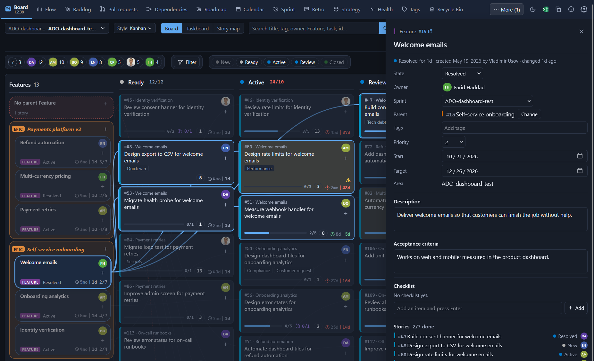
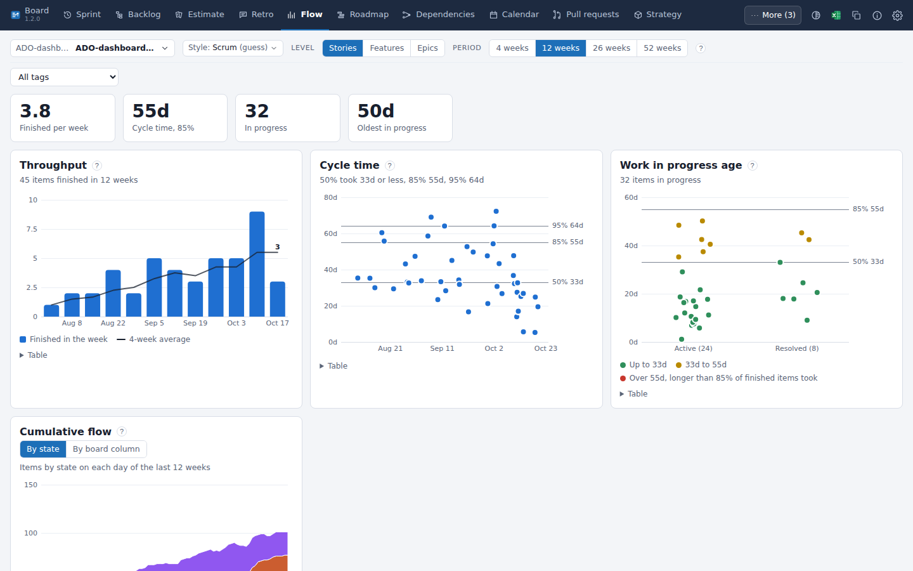

# Flowboards

**A complete re-imagining of the Azure DevOps UI experience, taken to the next level. Once tried, never go back.**

One page under **Boards** that shows a team's work in many ways and lets you change it in place.
Free and open source: <https://github.com/Volodymyr-Usov/flowboards>. Made by Volodymyr Usov: [usovvova.com](https://usovvova.com).

## Azure DevOps stores your work. Flowboards shows you what it means.

Your board, backlog and sprints tell you *what* the work is. The questions a team lead asks every week (when will it be done, where is it stuck, what is missing) usually take several screens, a query or another extension. Flowboards answers them on one page under **Boards**. Free, open source, nothing to host.

**The board, in dark mode.** Pick a Feature and its stories light up, joined to it by lines, with its details open on the right: stories, dependencies and pull requests. Flowboards follows Azure DevOps's light or dark theme.

### The five things teams notice first

1. **"When will it be done?" as a date with a likelihood.** A Monte Carlo forecast (10,000 runs) from your team's real pace: "85% likely by 14 Nov", or "85% likely 23 or more done by the end of the month". The Roadmap gives every Feature and Epic a "likely done by" date and turns it red when it will probably miss its target. Azure DevOps has no built-in forecast.
2. **A board that tells the story, and how urgent it is.** A story map and a board with stories joined to their Feature and grouped by Epic. Each card shows days in its column, task progress, linked pull requests, tags in colour and what it still misses. On the right edge of every story sit five small **urgency bars**, lit like a phone's charge: how important it is, how long it waits, how near its sprint's end and its deadline are, and what waits for it. The team sets what counts, and a pressing deadline can add up to half the score.
3. **Rules that live in the columns.** "Ready needs a description", "Active needs a task", "Only the product owner may close it": set once per column and inherited by the columns to its right. The ⚠ on a card says which rule it still misses; a move that breaks a rule stops and offers two ways out: move anyway, or fix what is missing right there.
4. **A Story Scheduler: recurring stories made for you.** The weekly review, the sprint kick-off, the release checklist: write them once as a schedule (on a date, weekly, monthly, at the start or end of a sprint, a month or a quarter) with a template (title, description, owner, tasks, sprint, board column), and the stories appear by themselves. The owner can rotate or be drawn at random, missed ones are made later, and the Calendar shows what is coming. Azure DevOps has nothing like it.
5. **Flow metrics and pull request times, for your team, without setup.** Throughput, cycle time, work-in-progress age and cumulative flow (by state or by board column), a forecast, and how long pull requests wait for their first approval and take to merge, over 4, 12, 26, 52 weeks or a period you choose. Every page says whose work it counts: your team's.

**Extremely flexible, and a lot in one place.** Almost everything can be shown, hidden or moved to taste, for you alone: every tab, every control of the two bars, every Board column (an eye on its title, arrows to bring it back), menu titles, card details, colouring rules, a switch for the ⚠ marks, filters on any property and the team's working style. Settings come in tabs, each setting with an icon and a description; one button resets the layout; pointing at anything explains it. Around that sit a backlog tree, a roadmap across teams, dependencies, a calendar with days off, sprint planning with capacity and burndown, retros, planning poker, health checks, tag tidying, a recycle bin, checklists and standard tasks.

### Safe to try

- **Least access.** It reads and writes work items, reads pull requests, and never gets permission to change your code.
- **Nothing to run.** No server, no token to paste: it uses your own Azure DevOps sign-in, in your browser. Your data stays in Azure DevOps.
- **Any process.** Agile, Scrum, Basic, CMMI and inherited processes, light and dark.
- **Open and tested.** MIT-licensed code your security team can read, unit-tested on every change, and checked every night against live Azure DevOps test projects.

Azure DevOps's own boards, burndown, velocity and Delivery Plans stay where they are. Flowboards adds to them; it does not replace them.

### Try it for one sprint

Install it for one team. If by the end of the sprint nobody is using the forecast or the story map, uninstall it. It cost nothing, and your data never left Azure DevOps.

## All features

### Plan

- **Board** — the team's real board columns, story cards joined by lines to their Feature, Features grouped by Epic. Drag a card to change its column, its priority or its Feature. Days in the column, task progress, pull requests counted for the whole story (its own and those of its tasks, each once; choose all, open or completed, and click the number for the list with links), what is missing, quick owner change, new tasks and stories in place. The **Story map** switch puts Features across the top and one row per sprint; drag a card down to another row to move it, with its open tasks, to that sprint. Search lifts matching cards to the top; person chips and filters hide the rest, and "Pick my next" picks only among the cards they show. Drag a task from a story's details onto another story card to move it (that card opens its tasks and shows the moved one in bold), **Split** a story in half (its tasks too) or make a **Follow-up** story with the same description in one click. Tags are drawn in colour (click one to pick another), a green **new** marks what was created today, and the Taskboard carries the Board's extras: age, colouring, pull requests, points and a bin on every task.
- **Backlog** — Epics, Features, stories and tasks as a tree with roll-ups; drag to re-parent or reorder; filter by person or by any property: type, state, owner, tags, sprint, dates, numbers or any other field. The first 150 rows show at once, then **Show more** (a search that finds fewer than 150 shows them all). A **priority score** column ("weighted shortest job first": business value, time criticality and risk reduction divided by size) sorts the work with one click.
- **Roadmap** — Epics and Features on a time line with sprints; drag to reschedule; dependency arrows; a "likely done by" date for each Feature and Epic from the team's pace, red when it will probably miss its target. Add **other teams**, of this project or other projects, each in its own rows (read-only), to see the dependencies between teams and where one team's work starts before what it waits for is done. Search and filters show the matching rows with the rows above them.
- **Dependencies** — which work waits for which, as a graph; blocked work and cycles are flagged. Search and filters show matching work with what it waits for and what waits for it.
- **Calendar** — target and due dates, sprint starts and ends, people's days off, team days off and team events (releases, holidays); days off go into each sprint's capacity, so sprint planning counts them. Search, person chips and filters pick which work shows; person chips also pick whose days off show. Stories the Scheduler will make show as small icons on their day.
- **Sprint** — the sprint goal at the top, written in place; backlog and sprint side by side, with search, person chips and filters, capacity per person, burndown, and a one-page sprint report with the sprint goal, what was finished, what is still open and the numbers; print it, save it as PDF or download it as Excel. When a sprint ends, one button moves the unfinished stories and their open tasks to the next sprint, or splits a story: its open tasks go to a copy in the next sprint, its finished work stays.
- **Retro** — sprint retrospectives: anonymous notes hidden until revealed, votes, and action items that become tasks.
- **Estimate** — planning poker: votes face down (hidden on screen), shown at once, the agreed number saved to the story.

The same **filters** work on every page with work items: click a person to see only their work, right-click to hide it, or press **Filter** to filter on any property. Each page keeps its own filters.

Every page looks the same, in two lines. The top line: the **team**, the working **style**, the tabs, then the theme, **Excel**, **Copy**, a **Reset** button (the layout back to the default), **About** and **Settings**. The second line: the **person chips** and **Filter** first, then the **Search** field and the page's own buttons; what does not fit goes under a **⋯** button. A tiny **×** that appears when you point at a tab or control hides it, and Settings > Menu & bars lists everything that can show or hide, each with an icon and a description. **Excel** and **Copy** take what the page shows: the Board's cards, or every table on the page, filters and sorting included.

**Choosing a team.** The first time you open the dashboard in a project it asks which team to show: your own teams first, then all teams of the project, with a search box and a project list. Your team opens directly when it is the one Azure DevOps opened and is not too big. The choice is kept in your browser; the team button at the start of the top line changes it (type to search, arrows and Enter, or click). A team whose area covers the whole project (more than 500 open stories) gets a note with a **Choose a team** button, and the Board stays fast: each column draws its first 50 cards with **Show more** below (the story map: 20 per cell and 30 Features at first), while search, filters, Excel and "Pick my next" still use every card.

- **Scheduler** — the team's recurring stories, created for you. A schedule says when (on a date; weekly or monthly; a date as an outlook; at the start, middle or end of every sprint; the start or end of a month or quarter) and holds a template: title, description, tags, owner (nobody, a person, rotating through the team, or random), the sprint it goes to (a rule or one chosen sprint), the board column it starts in, and tasks (none, the standard ones, or its own list). Whoever has Flowboards open makes the stories that are due, once only, and what was missed is made later, up to a week back. Anyone in the team can edit the schedules; "Make now" runs one on demand.

### Measure

- **Flow** — throughput, cycle time, work-in-progress age, cumulative flow (by state or by board column), a Monte Carlo forecast, and how long your team's pull requests wait for approval and take to merge (medians per week, kept in the team's storage); the period is 4, 12, 26 or 52 weeks, or a custom number of weeks. The page says it counts your team only.
- **Pull requests** — the team's open pull requests (those its members wrote or review; one click for everyone's), 150 rows at a time, with age, reviewers and who they wait on; a Review button that opens it on Azure DevOps's page; a filter by reviewer group; a weekly chart of the wait for the first approval and the time to merge; the stories each is linked to, likely stories for one with no link (Link in one click), and a "New pull request" link.
- **Strategy** — strategy pillars → Epics → Features with work closed per month; add, change and remove pillars right on the page.

### Check

- **Health** — work without a parent, owner, description or estimate; stale work; states that do not fit. Person chips and filters show only the findings you want. Starts on your team's areas, 100 findings per group at a time.
- **Tags** — likely duplicate, unused and rarely used tags: count, rename, merge or delete them. Starts on your team's tags, 100 rows at a time; the whole project is one click away.
- **Recycle Bin** (tab "Recycle") — deleted work items of the project, who deleted them and when; restore them with one click. It shows your team's deleted items by default (or the whole project), 100 at a time.

### Priority and urgency

Every story has an **urgency** from 0 to 100, drawn as five bars on its right edge (100 is five bars, 20 is one). It is worked out live from the story's priority, the priority of its Feature, how long it waits, the end of its sprint, the items waiting for it and (when you want) its value for the size. A deadline adds up to half the score on top as it comes closer. In Settings > Priority the team sets how much each counts. Nothing is written to Azure DevOps.

### The team's people

Azure DevOps lists everyone with access as a team member. In Settings > Team you untick those who only have access and add people who work with the team; the Scheduler's turns, the sprint capacity, the calendar's days off and the team's pull requests follow that list.

### Rules on moves

Set what work needs before it moves from one state or column to another: any fields that must be filled,
plus description, acceptance criteria, owner, tasks present or done, pull requests merged and more, and who alone may make the move.
A rule holds in its column and in every column to its right (a rule can start afresh at its column). The ⚠ on a card says which rule it still misses.
A move that breaks a rule is stopped, and the message lets you move anyway or fill in what is missing (a description, a task, an owner…) and move in one go.

### Checklists and definition of done

Every work item can have a checklist in its details panel: add, tick, rename, reorder and remove items; the panel's top shows
how many are ticked (3/5). The team keeps a default list per work item type in Settings (its "definition of done"); an item with
no checklist yet offers it with one click. The rule "Checklist done" stops a move until every item is ticked. An item with no
checklist passes, unless the team has a list for its type. Checklists are kept in this extension's storage, not in the work items.

### Standard tasks

Set the tasks a team adds under almost every story (for example "Write tests", "Update documentation"), with an optional
activity and hours. One click in a story's details panel adds the ones that are missing; a new story can get them at once.

**Flow, in light mode.** Throughput, cycle time and work-in-progress age of the last 12 weeks, read from the team's own work items.

## Questions and answers

**Is it free?** Yes. Flowboards is free and open source under the MIT license.

**What permissions does it ask for, and why?** Work items, read and write (to show your work and save the changes you make). Code, read only (to show pull requests: it can never change your code or approve, merge or abandon a pull request). Project and team, read (teams, sprints, board columns). Graph, read (people's pictures).

**Where is my data kept?** Your work stays in your work items. The team's settings (rules on moves, checklists, standard tasks, pillars), retros and planning poker are kept in this extension's storage in your organization. Your own view choices, such as filters, are kept in your browser and in your own storage in Azure DevOps (readable only by you), so they follow you to another browser. Nothing is sent anywhere else.

**Does it change my process, board or fields?** No. Moving a card changes the same fields the Azure DevOps board changes (state, board column, sprint, parent, order). Nothing is added to your process.

**Do the rules on moves also apply on the Azure DevOps board?** No. They apply to moves made in Flowboards. Azure DevOps's own pages follow your process rules only.

**Does it work with Azure DevOps Server (on-premises)?** No, only with Azure DevOps Services (dev.azure.com).

**We use Kanban, not sprints. Is it for us?** Yes. Each team has a working style (Scrum, Kanban or Scrumban), guessed from its sprints and changeable in Settings. For a Kanban team the board opens as the flow board, with the team's columns, WIP limits and days in column; Flow and Pull requests come first (every tab stays; you can switch off the ones you never use). Cumulative flow can show your board columns, and the forecast needs no sprints.

**How does the forecast work?** It takes how many items the team finished on each day of the last weeks (4 to 52, your choice) and plays the future 10,000 times, drawing each day at random from those days. "85% likely by 14 Nov" means 85 of those 10,000 runs finished by that date. It assumes the team keeps working as it did.

**Are anonymous retro notes really anonymous?** Yes. On a retro set to anonymous, notes are saved without the author's name. Notes stay hidden until they are revealed.

**Our project is big. Will it be slow?** A team whose area holds more than 500 open stories is asked to pick a smaller team, and the Board draws the first 50 cards per column with "Show more"; search, filters and Excel still use every card.

**What happens if we uninstall it?** Every change made with Flowboards stays in your work items. Rules, checklists and retros live in the extension's storage and are not shown without it.

**Is there AI?** Not in this release.

**How do I report a problem or ask for a feature?** Use the Q&A tab of this page, or write through [usovvova.com](https://usovvova.com).

## Privacy

Everything runs in your browser with your own Azure DevOps sign-in. Settings are kept in
this extension's storage in your organization. No data goes anywhere else.

## Author

Flowboards is made by Volodymyr Usov. More about me and my work: [usovvova.com](https://usovvova.com).
